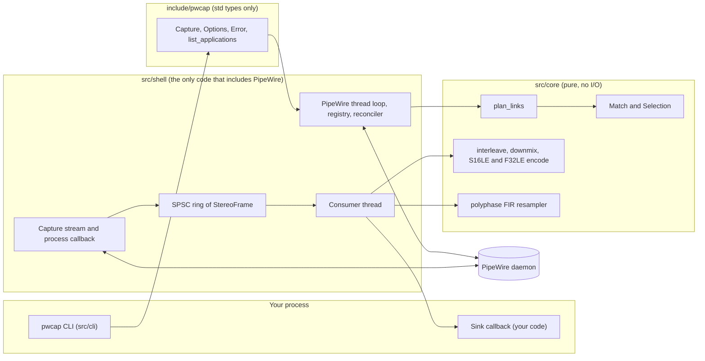
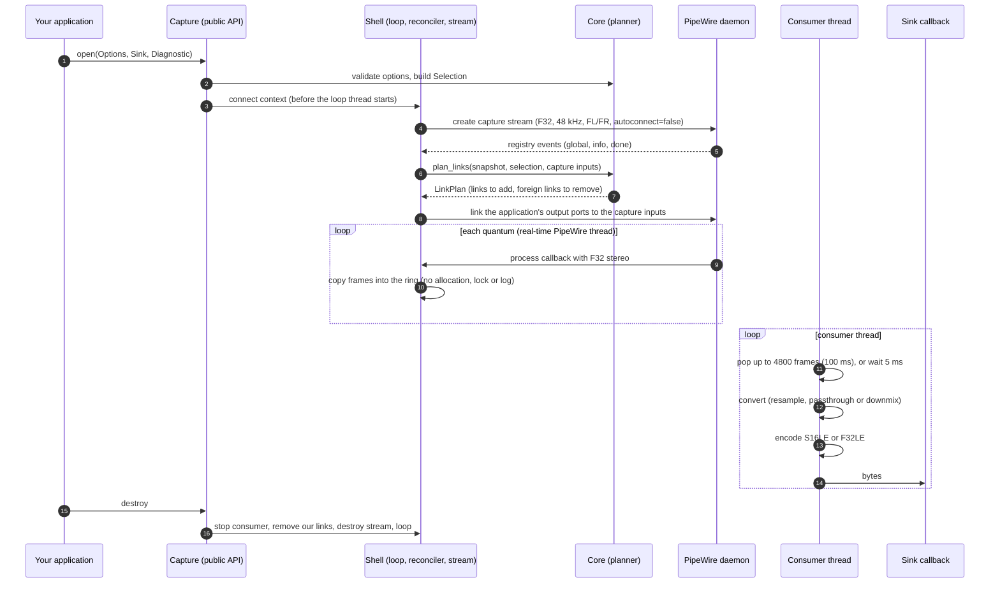

# pipewire-audio-capture

[](https://github.com/nemoe404/pipewire-app-capture/actions/workflows/ci.yml) [](https://github.com/nemoe404/pipewire-app-capture/releases/latest) [](LICENSE)

Capture the audio of **one application** on Linux (a Zoom call, a Google Meet tab, a media
player) without recording the system mix or your microphone. The audio goes out as raw PCM
(pulse-code modulation: uncompressed samples, no header) into a C++ callback, ready for a
script, `whisper.cpp`, or any other consumer.

> **Status: v0.1.0.** The C++ library works on PipeWire 1.6.2: `Capture::open` links one
> application's output into a capture stream and delivers PCM to your callback. The command-line
> tool (`pwcap`) and three examples (shell, Python, whisper.cpp) are part of this release. See
> [CHANGELOG.md](CHANGELOG.md) for what was verified.

## Why

PipeWire can capture the default output (everything you hear) or the microphone. It cannot
ask for "only Zoom" with a one-line command, and the usual answers involve moving streams
around, which silences the call for you. This library routes the one application's output
into a capture stream and leaves the application playing on your speakers as before.

## Usage (C++ API)

```cpp
#include <pwcap/capture.hpp>

#include <chrono>
#include <cstdio>
#include <span>
#include <string>
#include <string_view>
#include <thread>

int main() {
    pwcap::Options options;
    options.include.app_name = "Zoom";  // exact, case-sensitive match on application.name
    options.sample_rate = 16000;
    options.channels = 1;
    options.format = pwcap::SampleFormat::S16LE;

    auto capture = pwcap::Capture::open(
        options,
        [](std::span<const std::byte> pcm) {
            std::fwrite(pcm.data(), 1, pcm.size(), stdout);
        },
        [](std::string_view message) {
            std::fprintf(stderr, "%.*s\n", static_cast<int>(message.size()), message.data());
        });
    if (!capture) {
        std::fprintf(stderr, "%s\n", std::string(pwcap::to_string(capture.error())).c_str());
        return 1;
    }
    // The capture runs while `capture` is alive; this example records for 10 seconds.
    std::this_thread::sleep_for(std::chrono::seconds(10));
    return 0;
}
```

- `Options::include` and `Options::exclude` take `Match` values with `app_name`,
  `binary` (`application.process.binary`), `node_name` and `media_name` (for example a browser
  tab title). Empty fields match anything; `include` needs at least one non-empty field.
- Supported outputs: 16000 Hz mono, 48000 Hz stereo and 48000 Hz mono, each as `S16LE` or `F32LE`.
  The capture stream itself always runs at 48 kHz F32, FL/FR, and the library converts.
- Errors come back as `Error` values; `to_string(Error)` gives the name. Human-readable messages
  go to the `Diagnostic` callback. The library itself writes nothing to stdout or stderr.
- The sink and the diagnostic callback run on a library thread. Do not destroy the `Capture`
  from inside either of them.

The API is still a pre-release sketch. Its deviations from the first design are recorded in
`docs/plan/00-architecture.md`, section 5.

## Available now

- Select one application's output by `application.name`, `application.process.binary`,
  `node.name` or `media.name`, with exclude rules.
- Capture as 16 kHz mono (the format `whisper.cpp` expects), or as 48 kHz stereo or mono,
  in `S16LE` or `F32LE`.
- Wait with `NoMatchingSource` while the application has no output stream, and link it when it
  starts (`reconnect` is on by default).
- Re-link after the application restarts its stream (checked with a live test; see Limits).
- `pwcap list` and `pwcap capture` command-line tools, described in "Command-line tool" below.
- Examples that run against the installed tool: a shell one-liner, a Python consumer and a
  `whisper.cpp` pipeline (see "Examples").

## Architecture

The code has three layers. The public header uses only `std` types. The shell is the only code
that includes PipeWire, and it owns the threads. The core is pure value types and functions with
no I/O, so it is tested without a PipeWire session.

### Components



### Sequence: from `Capture::open` to the sink



### Audio processing

| Stage | What happens |
|---|---|
| Stream format | The capture stream always runs as F32, 48 kHz, stereo (FL, FR), with `node.autoconnect=false`. The library never asks the server to pick a source. |
| Linking | `plan_links` connects the application's output ports to the capture inputs by channel: FL to FL, FR to FR, and a MONO port matches either side. The application's own links to the speakers are not touched, so you keep hearing it. |
| Real-time copy | The process callback copies each frame (8 bytes, left and right) into a single-producer, single-consumer ring of 96 000 frames, which is 2 s at 48 kHz. Nothing is allocated, locked or logged on that path. |
| Overrun | When the ring is full the oldest frame is dropped. The drop count is reported through the diagnostic callback as `Overrun: dropped N frames`. |
| Consumer | One thread pops up to 4 800 frames per block (100 ms) and sleeps 5 ms when the ring is empty. It calls your sink, and never a PipeWire function. |
| Conversion | 48 kHz stereo to 48 kHz stereo is a passthrough. 48 kHz stereo to 48 kHz mono is the mean of left and right. 48 kHz stereo to 16 kHz mono runs the polyphase FIR resampler with the `hann-8` filter: a Hann-windowed sinc with 8 output periods on each side of its centre, and a cutoff at 0.9 of the 8 kHz output Nyquist. |
| Encoding | S16LE: each sample is clamped to [-1, 1] and rounded to `round(x * 32767)`. F32LE: the float samples are written as they are. |

The output size is fixed by the conversion and the format. For example, 16 kHz mono S16LE is two
bytes per sample, 32 000 bytes per second.

## Limits (read before you rely on it)

- **Linux with PipeWire only.** PulseAudio is supported through `pipewire-pulse`, not as a
  separate server. X11 (the X Window System), Wayland screencasting and macOS/Windows are out
  of scope.
- **Browser tabs: some can be told apart, some cannot.** Tested on PipeWire 1.6.2 with two
  playing tabs in each of Brave 1.100.58 (Chromium-based) and Firefox 160.0-1, both snap builds:
  each browser gave one output node per tab. Firefox puts the page title in `media.name`, so its
  tabs can be matched by that property. Brave's two nodes carry the same properties and differ
  only in id and `object.serial`, so a Brave tab cannot be matched by node properties.
- **A stream restart drops manual links.** Tested on PipeWire 1.6.2 with WirePlumber 0.5.13:
  when an application's stream is killed and started again, its links to the speakers come back
  by themselves within about 10 to 17 ms, but a capture link made by hand disappears about 2 ms
  after the kill and is not re-created within 3 s. The library re-links to the new ports (about
  60 ms in the live test). Node ids, port ids and `object.serial` all change on restart.
- **Targeting by `target.object` is only partly verified.** On the same versions, a capture
  stream targeted by serial or by name was linked to the right application while it played,
  with the same links as manual linking. After the application's stream restarted, a stream
  targeted by name was linked to the microphone within about 6 ms; with
  `node.dont-fallback=true` the stream was removed instead. The library itself
  never falls back to the microphone or to a monitor source.
- **libpipewire's own log lines are not redirected.** The library's diagnostics go to your
  callback, but libpipewire writes its log through its global logger, which the library does not
  change.
- **The resampler choice rests on a small measurement.** The 48 → 16 kHz filter (`hann8`) was
  picked by word error rate on 73 LibriSpeech utterances with `whisper.cpp` `base.en`. The
  differences between the three candidate filters were 2 to 5 words out of 1150, which is not
  statistically significant. The source was 16 kHz audio upsampled to 48 kHz, not a real 48 kHz
  capture.
- **`pwcap list` shows streams, not sound.** It lists streams whether or not they are audible, so a
  row does not mean that sound is playing. Use it to find a name, not to check that audio flows.
- **The examples were tested with test tones and LibriSpeech speech.** The whisper
  example was run with one model, `base.en`, on speech played through the speakers.
- **Recording a call may need consent.** Many jurisdictions require every participant's
  consent to record. You are responsible for that. This library records what you point it at
  and does nothing to notify anyone.
- **Not for hiding from anyone.** The library makes no attempt to conceal a capture from the
  application, the desktop, or screen-sharing and proctoring software.

## Dependencies

Tested on Ubuntu with PipeWire 1.6.2 and WirePlumber 0.5.13. Package names below are the Ubuntu ones.

**To build the library**

- clang 21 with C++23 (`clang-21`). The standard library is `libstdc++` from GCC 15
  (`libstdc++-15-dev`), the one clang picks up on this system.
- CMake 3.28 or newer (`cmake`), Ninja (`ninja-build`), pkg-config (`pkg-config`).
- PipeWire development files (`libpipewire-0.3-dev`), which provide `libpipewire-0.3` for pkg-config.
- Conan 2 (`pipx install conan`, or `pip install conan`). Conan downloads the test dependencies
  (GoogleTest 1.15.0 and nlohmann_json 3.12.0) the first time you run it, so this needs network access.
- For the `asan-ubsan` and `tsan` presets: the clang sanitizer runtimes (`libclang-rt-21-dev`).

**To run the live tests and the examples**

- A running PipeWire session with WirePlumber as the session manager (`pipewire`, `wireplumber`).
- The PipeWire command-line tools `pw-cli`, `pw-dump`, `pw-link` and `pw-play` (`pipewire-bin`).
  The test tools need only the Python 3 standard library.
- The examples need Python 3 (standard library only), coreutils `timeout` and `head`, and the
  installed `pwcap`. `ffmpeg` (`ffmpeg`) is optional, for the WAV conversion in the shell example.
- The whisper example also needs `whisper.cpp` built with a ggml model. Its README gives the fork
  and commit that were tested.

**For development checks (optional)**

- `clang-tidy-21` and `clang-format-21`, used by the lint gates.
- `cppcheck`, run by `scripts/cppcheck.sh`; `scripts/check.sh` runs the whole gate.

Install on Ubuntu:

```bash
sudo apt install clang-21 clang-tidy-21 clang-format-21 libclang-rt-21-dev libstdc++-15-dev \
    cmake ninja-build pkg-config libpipewire-0.3-dev pipewire pipewire-bin wireplumber
pipx install conan
```

## Install

This installs the library, the `pwcap` command-line tool and the CMake package to a prefix. It is
the plain Release configuration. It needs no Conan, because the tests are off by default
(`PWCAP_BUILD_TESTS=OFF`), so only the library build dependencies above are needed.

```bash
cmake -S . -B build/install -G Ninja -DCMAKE_BUILD_TYPE=Release -DCMAKE_CXX_COMPILER=clang++-21
cmake --build build/install
cmake --install build/install --prefix "$HOME/.local"
```

The install puts these files under the prefix (`$HOME/.local` here):

- `bin/pwcap`, the command-line tool;
- `include/pwcap/capture.hpp` and `include/pwcap/list.hpp`, the public headers and the only installed
  headers;
- `lib/libpwcap.a` and `lib/libpwcap_core.a`, the library;
- `lib/cmake/pwcap/`, the CMake package that `find_package(pwcap)` reads;
- `share/doc/pwcap/LICENSE`.

Put `$HOME/.local/bin` on your `PATH`. Then `command -v pwcap` prints `$HOME/.local/bin/pwcap`.

## Command-line tool

```
pwcap list [--json]
pwcap capture [--app NAME] [--binary NAME] [--node NAME] [--media NAME]
              [--exclude FIELD=VALUE]... [--rate HZ] [--channels N]
              [--format s16le|f32le] [--no-reconnect] [--quiet]
pwcap --help
```

`pwcap capture` writes the selected application's audio to stdout as raw PCM. At least one selector
is required. Selectors combine with AND, and each may appear once. Matching is exact and
case-sensitive.

| Flag | Matches |
| --- | --- |
| `--app NAME` | `application.name` |
| `--binary NAME` | `application.process.binary` |
| `--node NAME` | `node.name` |
| `--media NAME` | `media.name`, for example a browser tab title |

- `--exclude FIELD=VALUE` drops the streams whose FIELD (`app`, `binary`, `node` or `media`) equals
  VALUE. It may repeat.
- `--rate` and `--channels` default to 16000 and 1. `--format` defaults to `s16le`. The supported
  pairs are 16000/1, 48000/2 and 48000/1, in either format. Another pair exits 1 with
  `InvalidOptions`.
- Reconnect is on by default: `capture` waits while the application has no output stream, then links
  it when the stream starts. `--no-reconnect` ends the capture when the stream ends, or fails at
  start when nothing matches (`NoMatchingSource`).
- `--quiet` prints no diagnostics. The final error line is still printed.
- Stdout carries only the audio bytes. Diagnostics go to stderr.
- Stop a capture with SIGINT or SIGTERM. `pwcap` exits 0 after either signal.

Exit codes:

| Exit | Meaning |
| --- | --- |
| 0 | Stopped by SIGINT or SIGTERM, or the reader closed stdout (for example `head` after its bytes). |
| 1 | Runtime error. The last stderr line names it: `NoPipeWire` (no PipeWire session), `NoMatchingSource` (nothing matches and `--no-reconnect` is set), or `InvalidOptions` (an unsupported rate and channels pair). |
| 2 | Usage error: an unknown option, or no selector. |

`pwcap list` prints the applications that have an audio output stream. Text output is a header line
naming the columns `SERIAL`, `PID`, `APP`, `BINARY`, `NODE` and `MEDIA`, then one tab-separated row per
stream. `--json` prints one JSON
array of objects with the keys `serial`, `pid`, `app_name`, `binary`, `node_name` and `media_name`.
`pwcap list` shows streams, not whether they are audible. It does not show levels.

## Examples

These commands run against the installed `pwcap`. Run them from the repository root, because the
demo tone is generated by `tests/pipewire/tools/tones.py`. The demo starts a 440 Hz tone as an
application named `pwcap-demo`:

```bash
python3 tests/pipewire/tools/tones.py generate --freq 440 --seconds 60 --amplitude 0.1 --out tone440.wav
pw-play -P '{ application.name=pwcap-demo }' tone440.wav &
pwcap list
```

Record ten seconds of that application:

```bash
timeout --preserve-status -s INT 10 pwcap capture --app pwcap-demo > ten-seconds.raw
pwcap capture --app pwcap-demo | head -c 320000 > ten-seconds.raw
```

The first line stops after 10 seconds with SIGINT. The second writes exactly 320000 bytes (10
seconds of 16 kHz mono S16LE) and exits 0 when `head` closes the pipe. To convert that raw file to
WAV, with ffmpeg (optional):

```bash
ffmpeg -loglevel error -y -f s16le -ar 16000 -ac 1 -i ten-seconds.raw ten-seconds.wav
```

Print per-second levels and frequency of the same stream with the Python example (standard library
only). It prints one line per second and a total at the end:

```bash
timeout --preserve-status -s INT 10 pwcap capture --app pwcap-demo | python3 examples/python/pcm_levels.py
```

Transcribe the stream with `whisper.cpp`. Set `WHISPER_CLI` and `WHISPER_MODEL` first (the
whisper example README has the build). This runs until Ctrl-C:

```bash
pwcap capture --app pwcap-demo | python3 examples/whisper/transcribe.py --whisper-cli "$WHISPER_CLI" --model "$WHISPER_MODEL" --seconds 10
```

The same with a 30-second bound, which exits 0 when the capture ends:

```bash
timeout --preserve-status -s INT 30 pwcap capture --app pwcap-demo | python3 examples/whisper/transcribe.py --whisper-cli "$WHISPER_CLI" --model "$WHISPER_MODEL" --seconds 10
```

Each example has its own README with the full commands and what they show:

- [Shell](examples/shell/README.md): the one-liners above, and an ffmpeg conversion to WAV.
- [Python](examples/python/README.md): the per-second level script, its options and Ctrl-C behaviour.
- [whisper.cpp](examples/whisper/README.md): building the fork that was tested, the transcript
  format, the exit codes. Nothing leaves the machine.

## Build

Build with the dependencies above.

Test dependencies come from Conan, so generate the toolchain first. The profile is in
`conan/profiles/clang21`. Each build directory has its own `PWCAP_BUILD_ID`:

```bash
export PWCAP_BUILD_ID=dev
conan install . --output-folder=build/$PWCAP_BUILD_ID/conan \
    --profile:all=conan/profiles/clang21 -s "&:build_type=Debug" --build=missing
cmake --workflow --preset debug
```

Presets: `debug`, `asan-ubsan` (AddressSanitizer and UBSan), `tsan` (ThreadSanitizer) and
`release` (optimised, no sanitizers). For `release`, run `conan install` with
`-s "&:build_type=Release"` into its own `PWCAP_BUILD_ID`, because the toolchain file depends on
the build type.

Integration tests need a running PipeWire session. They are skipped unless
`PWCAP_TEST_PIPEWIRE=1` is set and `pw-cli info 0` answers, and the skip is printed. When they
run, they play quiet test tones through your speakers and check the graph before the levels.

## Link from your project

Install the library first (section Install). Then a CMake project that uses it needs only the
package and the target:

```cmake
find_package(pwcap 0.1 CONFIG REQUIRED)

add_executable(app app.cpp)
target_link_libraries(app PRIVATE pwcap::pwcap)
```

Configure the project with the install prefix on the search path:

```bash
cmake -S . -B build -DCMAKE_PREFIX_PATH="$HOME/.local"
cmake --build build
```

The repository's `tests/install/` directory holds a consumer project built this way. The install
check builds it out of tree against the installed package.

The usage example at the top of this file, saved as `app.cpp`, writes 16 kHz mono S16LE PCM to
stdout while it runs. Without a PipeWire session it prints `NoPipeWire` and exits with status 1.
An earlier build of the same program, compiled against the build tree, was checked with a 440 Hz
tone played by `pw-play`, with the app name changed from `"Zoom"` to `pw-play`. The file came out
7.98 s long with its peak at 440 Hz.

## Related projects

- [venmic](https://github.com/Vencord/venmic) — per-application PipeWire routing for Discord,
  MPL-2.0 (Mozilla Public License 2.0). It is a C++ library and a Node addon; its README says it
  is not meant for standalone use. This project aims at scripts and a documented CLI.
- [obs-pipewire-audio-capture](https://github.com/dimtpap/obs-pipewire-audio-capture) — an OBS
  (Open Broadcaster Software) Studio plugin, GPL-2.0 (GNU General Public License 2.0). It is an
  application plugin, not a library.

## Built on

This library is the audio-capture layer of [consigliere](https://consigliere.observer/), a visible desktop assistant for
technical interviews. Need to feed Zoom audio into Whisper in real-time? That's exactly what
consigliere does automatically.

## License

Apache-2.0. See [LICENSE](LICENSE).
